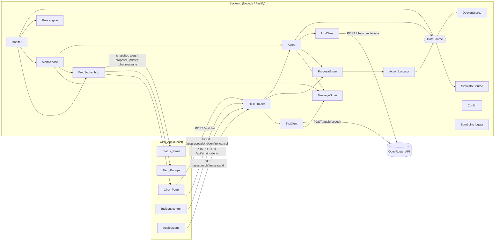
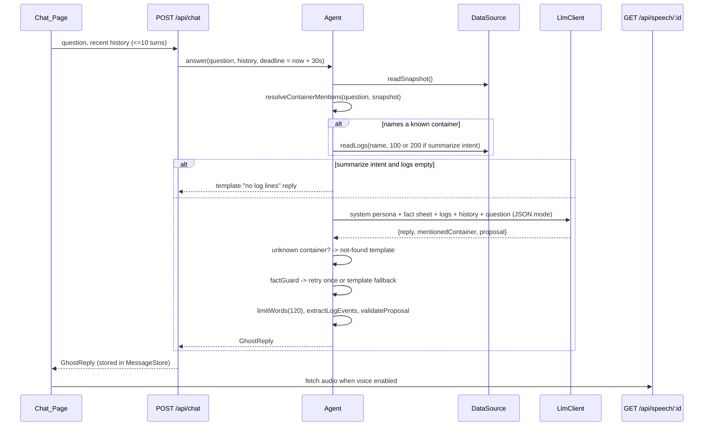
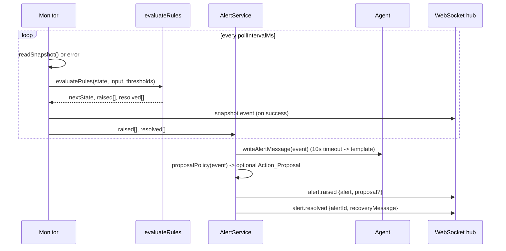

# Design Document: Haunted Homelab

## Overview

Haunted Homelab is a single Node.js process that serves a React web app and hosts an AI sysadmin agent. The backend reads homelab data through a `DataSource` interface with two implementations: `DockerSource` (Docker Engine API plus host OS metrics) and `SimulatorSource` (synthetic data with staged incidents for demo recording). A `Monitor` polls the data source, runs a pure rule engine, and emits alerts. The `Agent` turns user questions, log summaries, alerts, and action results into ghost-persona text through an LLM model on OpenRouter. A `TtsClient` turns that text into audio through a TTS model on OpenRouter. All AI calls use one OpenRouter API key. Restart and stop actions run only when the user confirms a pending proposal in the UI.

The design keeps the decision logic in pure, clock-injected functions (rule engine, simulator state, proposal store, prompt builder, fact guard, word limiter, config loader, secret scrubber). Network and timer code wraps those functions. This makes the important behavior testable with property-based tests and keeps the LLM's freedom limited to wording.

### Stack

| Concern | Choice | Reason |
|---|---|---|
| Language | TypeScript 5 (strict) on Node.js 20 LTS, shared by server and web | One language, shared types for API payloads |
| HTTP and WebSocket | Fastify 4, `@fastify/websocket`, `@fastify/static` | Small, schema-friendly, built-in WebSocket plugin |
| Validation | zod | Validates config, HTTP bodies, and LLM JSON output at trust boundaries |
| Docker access | dockerode | Supports Unix socket, Windows named pipe, and TCP endpoints |
| Host metrics | systeminformation | Cross-platform CPU, memory, and filesystem readings |
| LLM access | OpenRouter `POST /chat/completions` via the `openai` SDK with `baseURL: https://openrouter.ai/api/v1` | User decision: all AI usage goes through OpenRouter. The endpoint is OpenAI-compatible, so the official SDK works unchanged. |
| TTS access | OpenRouter `POST /audio/speech` via `fetch` | Same OpenRouter key and base URL. Returns raw audio bytes. |
| Logging | pino with a secret-scrubbing hook | Structured logs, keys removed before write |
| Web UI | React 18 + Vite, zustand for client state | Fast dev loop for the demo UI |
| Tests | Vitest, fast-check, @testing-library/react | Unit, property, and component tests in one runner |

### Key design decisions

1. **The LLM writes words, the backend owns facts.** Facts (container states, formatted metric values, log events, proposals) are computed deterministically. The LLM receives them as a fact sheet and returns prose. A fact guard checks the prose, and deterministic templates replace any output that fails the check or times out. This is how Requirements 5.1, 6.4, 7.2, 8.3, and 8.4 are met even when the LLM misbehaves.
2. **Pure rule engine.** `evaluateRules(state, input, thresholds)` returns the next state plus raised and resolved events. The `Monitor` only schedules polls and forwards events. Deduplication and resolution (4.8, 4.9) are properties of this function.
3. **Clock and randomness are injected.** `SimulatorSource` derives jitter from a hash of `(seed, containerName, tick)` rather than consuming a stateful RNG. Default values are therefore a pure function of seed and time, which makes "clear all returns to defaults" (3.10) exactly checkable.
4. **Speech by message ID.** The browser requests audio with `GET /api/speech/:messageId`. The server looks up the stored reply or alert text and sends only that text, with the configured TTS model, voice, instructions, and `mp3` format, to OpenRouter (13.2). The browser cannot make the server speak arbitrary text.
5. **Single action path.** The `ActionExecutor` is reachable only from `ProposalStore.confirm`. No HTTP route or agent code calls `DataSource.restart` or `DataSource.stop` directly (11.5).
6. **Localhost by default.** The server binds to `127.0.0.1` and checks the `Origin` header on mutating routes and WebSocket upgrades. There is no user authentication, and the design states this risk instead of adding an auth system that was not requested.

## Architecture



### Chat request flow



### Alert flow



`AlertService` processes events for the same alert key in order through a per-key promise chain, so a `resolved` event never overtakes the `raised` event it belongs to.

### Project layout

```
haunted/
  package.json            # scripts: dev, build, start, test (vitest --run), lint
  tsconfig.json
  vite.config.ts          # web build -> dist/web, dev proxy to backend
  haunted.config.example.json
  src/
    shared/               # types and pure helpers used by server and web
      types.ts            # Snapshot, ContainerInfo, HauntingAlert, GhostReply, API DTOs, WS events
      format.ts           # formatPercent, formatBytes, usagePercent
      words.ts            # countWords, limitWords
      severity.ts         # computeSeverityMarks
    server/
      main.ts             # loadConfig -> build components -> listen
      config/             # schema.ts, loadConfig.ts, publicConfig.ts
      logging/            # scrub.ts, logger.ts
      datasource/
        types.ts          # DataSource interface, errors
        factory.ts
        snapshot.ts       # readSnapshot(ds, clock)
        docker/           # DockerSource.ts, endpoint.ts, logs.ts (demux/parse), stats.ts
        simulator/        # SimulatorSource.ts, state.ts (pure), noise.ts, logs.ts
      monitor/            # rules.ts (pure engine), Monitor.ts (scheduler)
      alerts/             # AlertService.ts, templates.ts, proposalPolicy.ts
      agent/              # Agent.ts, prompt.ts, factSheet.ts, factGuard.ts,
                          # mentions.ts, logEvents.ts, replyTemplates.ts, persona.ts
      llm/                # LlmClient.ts, openrouter.ts
      tts/                # TtsClient.ts, openrouterTts.ts
      actions/            # ProposalStore.ts (pure state), ActionExecutor.ts
      messages/           # MessageStore.ts (bounded map of spoken texts)
      http/               # routes.ts, ws.ts, originGuard.ts
    web/
      main.tsx, App.tsx
      api/                # rest.ts, socket.ts (reconnecting WebSocket)
      state/              # store.ts (zustand), chatHistory.ts (sessionStorage)
      audio/              # AudioQueue.ts
      components/         # ChatPage, StatusPanel, AlertPopupStack, ProposalCard,
                          # IncidentControl, VoiceToggle, PrivacyNotice
  test/                   # mirrors src/, *.test.ts and *.property.test.ts
```

## Components and Interfaces

### Configuration (`server/config`)

Sources, in precedence order: environment variables, then the JSON config file at `HAUNTED_CONFIG` (default `./haunted.config.json`, optional), then defaults. The OpenRouter API key has no default.

| Setting | Env var | Config file key | Default |
|---|---|---|---|
| OpenRouter API key | `HAUNTED_OPENROUTER_API_KEY` | `openrouter.apiKey` | required |
| OpenRouter base URL | `HAUNTED_OPENROUTER_BASE_URL` | `openrouter.baseUrl` | `https://openrouter.ai/api/v1` |
| LLM model slug | `HAUNTED_LLM_MODEL` | `llm.model` | `openai/gpt-4o-mini` |
| TTS model slug | `HAUNTED_TTS_MODEL` | `tts.model` | `openai/gpt-4o-mini-tts-2025-12-15` |
| TTS voice | `HAUNTED_TTS_VOICE` | `tts.voice` | `onyx` |
| TTS instructions | `HAUNTED_TTS_INSTRUCTIONS` | `tts.instructions` | `Speak slowly in a hollow, eerie whisper, like a ghost trapped in the machine.` |
| Data source | `HAUNTED_DATA_SOURCE` | `dataSource` | `simulator` (`docker` \| `simulator`) |
| Docker endpoint | `HAUNTED_DOCKER_ENDPOINT` | `docker.endpoint` | `unix:///var/run/docker.sock`, or `npipe:////./pipe/docker_engine` on Windows |
| Polling interval | `HAUNTED_POLL_INTERVAL_MS` | `monitor.pollIntervalMs` | `5000` |
| CPU threshold / duration | `HAUNTED_CPU_THRESHOLD`, `HAUNTED_CPU_DURATION_S` | `thresholds.cpuPercent`, `thresholds.cpuDurationSeconds` | `90`, `30` |
| Memory threshold | `HAUNTED_MEMORY_THRESHOLD` | `thresholds.memoryPercent` | `90` |
| Disk threshold | `HAUNTED_DISK_THRESHOLD` | `thresholds.diskPercent` | `90` |
| Bind host / port | `HAUNTED_HOST`, `HAUNTED_PORT` | `server.host`, `server.port` | `127.0.0.1`, `3000` |
| Simulator seed | `HAUNTED_SIM_SEED` | `simulator.seed` | `1337` |

```typescript
export const DATA_SOURCE_NAMES = ["docker", "simulator"] as const;

export interface Config {
  openrouter: { apiKey: string; baseUrl: string };
  llm: { model: string };
  tts: { model: string; voice: string; instructions?: string };   // empty instructions string -> undefined
  dataSource: (typeof DATA_SOURCE_NAMES)[number];
  docker: { endpoint: string };
  monitor: { pollIntervalMs: number };
  thresholds: { cpuPercent: number; cpuDurationSeconds: number; memoryPercent: number; diskPercent: number };
  server: { host: string; port: number };
  simulator: { seed: number };
}

export class ConfigError extends Error {
  constructor(readonly problems: string[]) {
    super(`Invalid configuration:\n- ${problems.join("\n- ")}`);
  }
}

/** Pure: no process.env or fs access. main.ts passes process.env and the parsed file. */
export function loadConfig(env: Record<string, string | undefined>, file: unknown): Config;

/** Whitelisted projection sent to the browser. Never contains the API key, the OpenRouter base URL, or the Docker endpoint. */
export interface PublicConfig {
  dataSource: Config["dataSource"];
  aiGateway: "openrouter"; llmModel: string; ttsModel: string;
  pollIntervalMs: number; thresholds: Config["thresholds"];
}
export function toPublicConfig(c: Config): PublicConfig;
```

`loadConfig` collects every problem before throwing, so a single error lists every problem, including a missing or empty `HAUNTED_OPENROUTER_API_KEY` named by its setting (12.3). Model slugs and the voice are not validated against OpenRouter at startup, because available models and voices change; an invalid slug or voice surfaces as an OpenRouter error at request time. An unknown data source produces `Unknown data source "<value>". Valid data sources: docker, simulator` (1.3). `main.ts` catches `ConfigError`, prints the message to stderr, and exits with code 1. Numeric env vars are parsed strictly; non-numeric or out-of-range values (thresholds outside 1–100, interval below 1000 ms) are reported as problems.

### Logging (`server/logging`)

```typescript
/** Replaces every occurrence of each non-empty secret with "[REDACTED]" in strings, recursively in objects/arrays/Error messages. */
export function scrubDeep<T>(value: T, secrets: readonly string[]): T;

export function createLogger(secrets: readonly string[]): pino.Logger;
```

`createLogger` installs a pino `hooks.logMethod` that runs `scrubDeep` on every argument and a `redact` list for `*.apiKey`, `*.headers.authorization`, `*.headers.Authorization`. The OpenRouter API key is the only secret passed to `createLogger`. All server code logs through this logger. HTTP error responses carry persona messages built from templates, not raw provider errors, so provider error bodies never reach the browser (12.4).

### Data source layer (`server/datasource`)

```typescript
export interface DataSource {
  readonly kind: "docker" | "simulator";
  listContainers(): Promise<ContainerInfo[]>;
  readLogs(name: string, maxLines: number): Promise<LogLine[]>;   // most recent, oldest first
  readHostMetrics(): Promise<HostMetrics>;
  restart(name: string): Promise<void>;
  stop(name: string): Promise<void>;
}

export class DataSourceUnavailableError extends Error {
  constructor(readonly endpoint: string, cause?: unknown) {
    super(`Data source unavailable at ${endpoint}`); this.cause = cause;
  }
}
export class ContainerNotFoundError extends Error {
  constructor(readonly containerName: string) { super(`Container not found: ${containerName}`); }
}
export class DataSourceActionError extends Error {}   // Docker API error text for restart/stop

export function createDataSource(config: Config, clock: Clock, logger: Logger): DataSource;

/** Reads containers and host metrics in parallel and stamps readAt from the clock. */
export function readSnapshot(ds: DataSource, clock: Clock): Promise<Snapshot>;
```

Only `datasource/` may import `dockerode` or `systeminformation`. An ESLint `no-restricted-imports` rule enforces this (1.4). The Web_App gets data only from backend events that originate in `readSnapshot`.

#### DockerSource

- **Endpoint parsing** (`endpoint.ts`): `unix://` and `npipe://` map to dockerode `socketPath`; `tcp://` and `http://` map to `host` and `port`.
- **listContainers**: `docker.listContainers({ all: true })` so stopped containers are included (2.1). Names are taken from `Names[0]` without the leading `/`. For running containers, `container.stats({ stream: false })` runs in parallel with a concurrency limit of 8. Non-running containers report 0 CPU and 0 memory.
- **CPU and memory** (`stats.ts`, pure):

```typescript
export function computeCpuPercent(s: DockerStats): number {
  const cpuDelta = s.cpu_stats.cpu_usage.total_usage - s.precpu_stats.cpu_usage.total_usage;
  const sysDelta = (s.cpu_stats.system_cpu_usage ?? 0) - (s.precpu_stats.system_cpu_usage ?? 0);
  const cpus = s.cpu_stats.online_cpus ?? s.cpu_stats.cpu_usage.percpu_usage?.length ?? 1;
  return cpuDelta > 0 && sysDelta > 0 ? (cpuDelta / sysDelta) * cpus * 100 : 0;
}
export function computeMemoryBytes(s: DockerStats): number {
  const cache = s.memory_stats.stats?.inactive_file ?? s.memory_stats.stats?.cache ?? 0;
  return Math.max(0, (s.memory_stats.usage ?? 0) - cache);
}
```

- **readLogs** (`logs.ts`): `container.logs({ stdout: true, stderr: true, timestamps: true, tail: maxLines })`. When the container has no TTY (`inspect().Config.Tty === false`), the buffer is demultiplexed from Docker's 8-byte frame headers (`[stream, 0, 0, 0, size32BE]`). Each line is split at the first space into an RFC 3339 timestamp and text (2.2). The function then keeps the last `maxLines` lines.

```typescript
export function demuxDockerStream(buf: Buffer): { stream: "stdout" | "stderr"; payload: string }[];
export function parseTimestampedLines(payload: string, stream: "stdout" | "stderr"): LogLine[];
```

- **readHostMetrics**: `si.currentLoad().currentLoad`, `si.mem()` (`active` as used, `total`), `si.fsSize()` mapped to `{ mount, usedBytes, totalBytes }` (2.3). If the backend runs inside a container, the user must mount host `/proc` and filesystems for these readings to describe the host. The README will state this.
- **restart / stop**: `getContainer(name).restart()` / `.stop()` (2.4).
- **Error mapping**: socket errors `ECONNREFUSED`, `ENOENT`, `EACCES`, `ETIMEDOUT`, `EPIPE` become `DataSourceUnavailableError(endpoint)` (2.5). HTTP 404 becomes `ContainerNotFoundError(name)` (2.6). Other Docker errors on restart or stop become `DataSourceActionError` with the Docker message.

#### SimulatorSource

The simulator is a thin async wrapper around a pure state module.

```typescript
export type IncidentType = "cpu_spike" | "memory_leak" | "disk_full" | "container_crash" | "container_restart_loop";
export const CONTAINER_INCIDENTS: IncidentType[] = ["memory_leak", "container_crash", "container_restart_loop"];
export const GHOST_CONTAINER = "unknown-process-x13";

export interface StagedIncident { type: IncidentType; target?: string; stagedAt: number; leakBytes?: number }

export interface SimState {
  seed: number;
  incidents: StagedIncident[];
  stopped: Set<string>;               // containers stopped by request
  logs: Map<string, LogLine[]>;       // ring buffer, 1000 lines per container
  lastLogTick: Map<string, number>;
}

export function initialState(seed: number): SimState;
export function stageIncident(s: SimState, type: IncidentType, target: string | undefined, now: number): SimState;
export function clearIncidents(s: SimState, now: number): SimState;
export function restartContainer(s: SimState, name: string, now: number): SimState;
export function stopContainer(s: SimState, name: string, now: number): SimState;
/** Advances lazy state (leak growth, log generation) and returns the observed view. */
export function observe(s: SimState, now: number): { state: SimState; containers: ContainerInfo[]; host: HostMetrics };
```

Default model (3.1):

- Host: 8 cores, 32 GiB memory, base used 4 GiB plus the sum of container memory. Filesystems `/` (512 GB, 35–45 % used) and `/mnt/media` (4 TB, 55–65 % used).
- Containers: `plex`, `pihole`, `homeassistant`, `nginx-proxy`, `uptime-kuma`. Each is running with CPU between 2 % and 25 % and memory between 150 MiB and 1.5 GiB. The sum stays under 10 GiB, so host memory is under 45 %.
- Jitter comes from `noise(seed, key, tick)`, a 32-bit hash (mulberry32 over an FNV-1a hash of the inputs) with `tick = floor(now / 5000)`. Defaults are a pure function of `(seed, now)`.

Logs (3.2): every 5-second tick, each running container gains one or two lines from a per-service template list (for example plex `Transcoder session started`, pihole `query[A] example.com from 192.168.1.20`). Generation is lazy: `observe` and `readLogs` fill in all ticks since `lastLogTick`, using tick timestamps. Every 10-second window therefore contains at least one line per running container.

Incident effects:

| Incident | Target | Effect while staged |
|---|---|---|
| `cpu_spike` | none | Host CPU 96–99 %. Adds `unknown-process-x13`, running, CPU 96–99 %, 64 MiB (3.4). CPU above 90 % satisfies the strict "more than the threshold" rule in 4.7. |
| `memory_leak` | existing container | Each `observe` adds 4 % of host memory to `leakBytes` until host memory used ≥ 95 %, then holds (3.5). The cap keeps host memory ≤ 99 %. |
| `disk_full` | none | `/` used 97 % (3.6). |
| `container_crash` | existing container | State `exited`, CPU and memory 0. On staging, appends 3 error lines such as `FATAL: unhandled exception in worker thread: segmentation fault` (3.7). |
| `container_restart_loop` | existing container | State `restarting`. Each tick appends `ERROR: startup failed: could not bind to port <port>, retrying` (3.8). |

Operation rules:

- Staging validates the target. Container incidents require an existing simulator container (`ContainerNotFoundError` otherwise). Each container has at most one container incident, and a new one replaces the old one. Staging the same host incident twice is idempotent.
- `restartContainer(name)` removes `name` from `stopped` and removes incidents whose target is `name`. Restarting `unknown-process-x13` removes `cpu_spike` and the ghost container. The result is that the container reports `running` (3.9). An unknown name raises `ContainerNotFoundError`.
- `stopContainer(name)` adds `name` to `stopped` and removes container incidents targeting it. Stopping `unknown-process-x13` ends the host CPU effect of `cpu_spike` while the ghost container stays listed as `exited` (3.11).
- `clearIncidents` empties `incidents` and `stopped`. Logs are kept because they are history. Every container and the host return to the default model (3.10).

Incident control endpoints exist only when `dataSource === "simulator"`. Otherwise they return 404.

### Monitor and rule engine (`server/monitor`)

```typescript
export type AlertRuleId =
  | "host_cpu" | "host_memory" | "disk" | "container_exited"
  | "container_restarting" | "new_container_cpu" | "data_source_unavailable";

export type AlertSubject =
  | { kind: "host"; resource: "cpu" | "memory" }
  | { kind: "filesystem"; mount: string }
  | { kind: "container"; name: string }
  | { kind: "data_source" };

export interface AlertEvent {
  key: string;                 // `${ruleId}:${subjectKey(subject)}`
  ruleId: AlertRuleId;
  subject: AlertSubject;
  severity: "warning" | "critical";
  measuredValue: string;       // formatted, e.g. "97.3%", "exited", "restarting"
  detectedAt: string;          // ISO time of the triggering snapshot or failed read
}

export interface RuleState {
  previous?: Snapshot;
  cpuAboveSince?: number;            // readAt (ms) of first snapshot in current above-threshold run
  exitedLatch: Set<string>;          // containers that went running -> exited
  newHotLatch: Set<string>;          // containers that appeared hot after a previous snapshot existed
  active: Map<string, AlertEvent>;
}

export type MonitorInput =
  | { ok: true; snapshot: Snapshot }
  | { ok: false; at: string; error: string };

export function evaluateRules(state: RuleState, input: MonitorInput, t: Thresholds):
  { state: RuleState; raised: AlertEvent[]; resolved: AlertEvent[] };
```

Rule conditions for a successful snapshot `S` with previous snapshot `P`:

| Rule | Condition | Severity | Measured value |
|---|---|---|---|
| `host_cpu` | `S.host.cpuPercent > cpuPercent` and `S.readAt − cpuAboveSince ≥ cpuDurationSeconds·1000`. `cpuAboveSince` is set on the first snapshot of a run above the threshold and cleared by any snapshot at or below it (4.2). | warning | host CPU % |
| `host_memory` | `used/total·100 > memoryPercent` (4.3) | warning | memory % |
| `disk` per mount | `used/total·100 > diskPercent` (4.4) | warning | disk % |
| `container_exited` | Latched when `P` has the container `running` and `S` has it `exited`. Stays true while the container is present and `exited` (4.5). | critical | `exited` |
| `container_restarting` | Container state is `restarting` (4.6). | critical | `restarting` |
| `new_container_cpu` | Latched when `P` exists, the container is absent from `P`, and its CPU is above `cpuPercent`. Stays true while it is present with CPU above `cpuPercent` (4.7). | warning | container CPU % |
| `data_source_unavailable` | Input is `{ ok: false }`. Stays true until the next successful input (4.10). | critical | error summary |

Engine steps:

1. Compute the set of currently true condition keys. On `{ ok: false }`, the only change is that `data_source_unavailable` becomes true. Every other rule keeps its active state, `previous`, and `cpuAboveSince`, because a failed read is not a snapshot.
2. `raised` contains keys that are true and not in `active` (4.8). `resolved` contains keys in `active` that are no longer true (4.9).
3. The first successful snapshot sets `previous` and raises no `new_container_cpu` alerts, because there is nothing to compare with.

`Monitor` runs a `setTimeout` loop. Each tick starts at `start + n·interval`, reads a snapshot with a timeout of `min(interval, 10s)`, calls `evaluateRules`, broadcasts `snapshot`, and hands events to `AlertService`. If a read overruns, the next tick is skipped rather than overlapped (4.1, 4.10).

### Alerts (`server/alerts`)

```typescript
export interface HauntingAlert extends AlertEvent {
  id: string;                       // uuid; also the MessageStore id for speech
  message: string;                  // persona text, <= 40 words
  status: "active" | "resolved";
  resolvedAt?: string;
  recoveryMessageId?: string;
  recoveryMessage?: string;
  proposalId?: string;
}

export class AlertService {
  constructor(deps: { agent: Agent; proposals: ProposalStore; hub: WsHub; messages: MessageStore; clock: Clock });
  handle(raised: AlertEvent[], resolved: AlertEvent[]): void;
  activeAlerts(): HauntingAlert[];
}

/** Deterministic: the measured value and subject label always appear verbatim. */
export function alertTemplate(e: AlertEvent): string;
export function recoveryTemplate(e: AlertEvent): string;
export function subjectLabel(s: AlertSubject): string;   // "plex", "host CPU", "filesystem /", "data source"

/** container_exited, container_restarting -> restart; new_container_cpu -> stop; others -> none. */
export function proposalPolicy(e: AlertEvent): { action: "restart" | "stop"; container: string; reason: string } | null;
```

Template examples:
- `alertTemplate` for `host_cpu`: `A strange process is haunting the CPU. The host CPU burns at 97.3% and will not rest.`
- `alertTemplate` for `container_exited`: `The spirit of plex has left its vessel. It now lies exited in the dark.`
- `recoveryTemplate`: `The haunting of host CPU has lifted. The machine breathes easy again.`

`Agent.writeAlertMessage` asks the LLM for one sentence of at most 40 words with a 10-second timeout. `acceptAlertText(candidate, event)` accepts the text only if it contains `subjectLabel` (or the container name) and `measuredValue` verbatim and has at most 40 words. Otherwise, and on any error or timeout, the template is used (5.1, 5.5, 8.3). Recovery messages use `recoveryTemplate` directly (5.6). This keeps recovery popups instant and costs no LLM calls.

### Agent (`server/agent`)

```typescript
export interface ChatTurn { role: "user" | "ghost"; text: string }

export interface GhostReply {
  id: string;
  text: string;                     // spoken text, <= 120 words
  events?: LogEvent[];              // log summaries: rendered as a list, not spoken
  proposal?: ActionProposalDTO;
  createdAt: string;
}

export class Agent {
  constructor(deps: { ds: DataSource; llm: LlmClient; proposals: ProposalStore; messages: MessageStore; clock: Clock; logger: Logger });
  answer(question: string, history: ChatTurn[], deadline: number): Promise<GhostReply>;
  writeAlertMessage(e: AlertEvent): Promise<string>;
  reportActionResult(p: ActionProposal, result: ActionResult): Promise<GhostReply>;
}
```

`answer` steps:

1. `snapshot = await readSnapshot(ds)`. If the read fails, the reply is a persona error and the HTTP status is 502.
2. `mentions = resolveContainerMentions(question, snapshot.containers)`. Matching is case-insensitive on whole words and treats `-`, `_`, and spaces as equivalent, so "Pi hole" matches `pihole` and "home assistant" matches `homeassistant`.
3. `intent = detectIntent(question)`. A question whose words include `summarize`, `summarise`, `summary`, or `logs` is a `summarize` intent. All other questions are `chat`.
4. For the first mentioned container, read logs with `maxLines = intent === "summarize" ? 200 : 100` (6.2, 7.1). If the intent is `summarize` and no container is mentioned, the agent asks which container and lists the names. If the intent is `summarize` and the log is empty, the agent returns `noLogsTemplate(name)` without an LLM call (7.3).
5. Build the request with `buildChatPrompt` and call the LLM in JSON mode. The remaining time before the deadline is the timeout (6.7).
6. Parse `{ reply, mentionedContainer, proposal }` with zod. If parsing fails, the raw text becomes `reply` and the other fields are null.
7. If `mentionedContainer` is non-null and matches no existing container, return `unknownContainerReply(name, names)` (6.5). If it matches a known container whose logs were not included and time remains, repeat step 5 once with those logs.
8. Run `factGuard(reply, allowed)`. On violations, retry once with a corrective message that lists the invalid values, if time remains. If the second reply also fails, use `factTemplateReply(snapshot, mentions)` (6.4, 8.4).
9. `text = limitWords(text, 120)` (8.2). For `summarize`, `events = extractLogEvents(lines)` (7.2).
10. `validateProposal(proposal, snapshot)` keeps only `restart` or `stop` on an existing container with a non-empty reason (11.1, 11.3). A valid proposal is registered in `ProposalStore`.
11. Store the text in `MessageStore` and return the `GhostReply`.

#### Prompt builder (`prompt.ts`)

```typescript
export const PERSONA_SYSTEM_PROMPT: string; // ghost-in-the-machine voice, spooky metaphors,
// quote every container name and number exactly as written in FACTS, <= 120 words,
// propose only "restart" or "stop" for a listed container, respond as JSON {reply, mentionedContainer, proposal}

export interface LlmRequest { system: string; messages: { role: "user" | "assistant"; content: string }[]; maxTokens: number; json: boolean }

export function buildChatPrompt(input: {
  question: string;
  history: ChatTurn[];        // last 10 turns, each truncated to 2000 chars
  facts: FactSheet;
  logs?: { container: string; lines: LogLine[]; limit: 100 | 200 };
  intent: "chat" | "summarize";
}): LlmRequest;
```

The final user message has these sections: `FACTS` (one line per fact), `LOGS <name>` (the last `limit` lines as `timestamp text`), `LOG EVENTS` (output of `extractLogEvents` for summaries, so the LLM sees the same events the UI lists), and `QUESTION`. Nothing else is added. Config values, endpoints, and environment data never enter the builder because it does not receive them (13.1).

#### Facts and guard (`factSheet.ts`, `factGuard.ts`)

```typescript
export interface FactSheet {
  host: { cpu: string; memory: string; memoryUsed: string; memoryTotal: string; disks: { mount: string; used: string }[] };
  containers: { name: string; state: ContainerState; cpu: string; memory: string }[];
}
export function buildFactSheet(s: Snapshot): FactSheet;     // uses formatPercent (1 decimal + "%") and formatBytes ("512.0 MiB")

/** Numeric tokens with units: /(\d+(?:\.\d+)?)\s?(%|[KMGT]i?B\b|bytes\b)/gi, normalized by removing whitespace. */
export function extractQuantities(text: string): string[];
export function allowedQuantities(f: FactSheet, extraTexts: string[]): Set<string>; // facts + question + included logs
export function factGuard(reply: string, allowed: Set<string>): { ok: true } | { ok: false; invalid: string[] };
export function factTemplateReply(s: Snapshot, mentions: string[]): string;
```

The guard checks quantities. It cannot detect invented container names in free prose. The system prompt and fact sheet reduce that risk, and the not-found path (step 7) handles names the LLM reports.

#### Log events (`logEvents.ts`)

```typescript
export interface LogEvent { timestamp: string; level: "error" | "warning"; text: string }
/** error: /\b(error|err|fatal|panic|exception|crit(ical)?)\b/i; warning: /\b(warn|warning)\b/i. Error wins when both match. */
export function classifyLine(text: string): "error" | "warning" | null;
export function extractLogEvents(lines: LogLine[]): LogEvent[];
```

The UI renders `events` as a list under the spoken summary, with timestamps (7.2).

#### Persona templates (`replyTemplates.ts`)

`unknownContainerReply(name, existing)`, `noLogsTemplate(name)`, `chatFailureMessage()`, `actionResultReply(p, result)`, and `factTemplateReply(...)` are deterministic and limited to 120 words. When `unknownContainerReply` would exceed 120 spoken words, the full name list moves into a non-spoken `list` field that the Chat_Page renders. The spoken text then says the list is shown.

### LLM client (`server/llm`)

```typescript
/** Test seam only: production always uses OpenRouterLlm. Tests inject a mock. */
export interface LlmProvider { complete(req: LlmRequest, signal: AbortSignal): Promise<string> }
export class LlmClient {
  constructor(provider: LlmProvider, logger: Logger);
  complete(req: LlmRequest, timeoutMs: number): Promise<string>;  // AbortController timeout -> LlmTimeoutError
}

/** openrouter.ts */
export class OpenRouterLlm implements LlmProvider {
  constructor(opts: { apiKey: string; baseUrl: string; model: string });
}
```

`OpenRouterLlm` creates `new OpenAI({ apiKey, baseURL: baseUrl, maxRetries: 0, defaultHeaders: { "X-Title": "Haunted Homelab" } })`. The SDK sends `Authorization: Bearer <key>`. `complete` calls `chat.completions.create({ model, messages: [{ role: "system", content: req.system }, ...req.messages], max_tokens: req.maxTokens, response_format: req.json ? { type: "json_object" } : undefined }, { signal })` and returns the first choice's message content. Not every OpenRouter model honors `response_format`, so the Agent's zod parse with raw-text fallback (step 6) stays in place. No automatic retries; the Agent controls retries within the deadline. OpenRouter error responses become provider errors that the route maps to 502.

### TTS client (`server/tts`) and speech route

```typescript
export interface TtsRequest { model: string; input: string; voice: string; instructions?: string; response_format: "mp3" }

/** Test seam only: production always uses OpenRouterTts. Tests inject a mock. */
export interface TtsProvider { synthesize(req: TtsRequest, signal: AbortSignal): Promise<{ audio: Buffer; mimeType: string }> }
export class TtsClient {
  constructor(provider: TtsProvider, settings: Config["tts"], logger: Logger);
  /** Always uses the configured model, voice (9.2), and instructions (9.7), and always requests mp3 (9.6). */
  speak(text: string, timeoutMs = 15_000): Promise<{ audio: Buffer; mimeType: string }>;
}

/** openrouterTts.ts */
export class OpenRouterTts implements TtsProvider {
  constructor(opts: { apiKey: string; baseUrl: string });
}
```

- `TtsClient.speak` builds `{ model, input: text, voice, response_format: "mp3" }` and adds `instructions` only when the configured value is non-empty. Nothing else goes into the request (13.2).
- `OpenRouterTts.synthesize` sends `POST {baseUrl}/audio/speech` with `fetch`, headers `Authorization: Bearer <key>`, `Content-Type: application/json`, and `X-Title: Haunted Homelab`, and the `TtsRequest` as the JSON body. OpenRouter defaults `response_format` to `pcm`, which browsers cannot play from an `<audio>` element, so `mp3` is always sent. A 200 response is a raw audio byte stream, returned as `{ audio, mimeType: "audio/mpeg" }`. A non-200 response is a JSON error; its `error.message` becomes a `TtsProviderError`. The `instructions` field is honored by models such as OpenAI gpt-4o-mini-tts and Gemini TTS and ignored by others. Voice names differ per model, so changing `HAUNTED_TTS_MODEL` may require changing `HAUNTED_TTS_VOICE`.
- `GET /api/speech/:messageId` looks up the text in `MessageStore`, calls `TtsClient.speak(text)`, caches the audio for that id, and returns `audio/mpeg`. An unknown id returns 404. Provider failure or timeout returns 502 or 504 (9.5).
- `MessageStore` is a bounded map of the 500 most recent spoken texts (ghost replies, alert messages, recovery messages).

### Proposals and actions (`server/actions`)

```typescript
export type ProposalStatus = "pending" | "confirmed" | "cancelled" | "expired";
export const PROPOSAL_TTL_MS = 5 * 60 * 1000;

export interface ActionProposal {
  id: string; action: "restart" | "stop"; container: string; reason: string;
  createdAt: number; status: ProposalStatus; source: "chat" | "alert";
}

export type ConfirmDecision =
  | { kind: "execute"; proposal: ActionProposal }
  | { kind: "rejected"; reason: "expired" | "already_confirmed" | "already_cancelled" | "already_expired" | "not_found" };

/** Pure state transitions. */
export function createProposal(s: ProposalState, p: Omit<ActionProposal, "status">): ProposalState;
export function confirm(s: ProposalState, id: string, now: number): { state: ProposalState; decision: ConfirmDecision };
export function cancel(s: ProposalState, id: string): { state: ProposalState; ok: boolean };

export interface ActionResult { ok: boolean; error?: string }
export class ActionExecutor {
  constructor(ds: DataSource);
  run(p: ActionProposal): Promise<ActionResult>;   // calls ds.restart or ds.stop; maps errors to their message
}
```

`confirm` marks a pending proposal `confirmed` before the action runs, so a second confirm that arrives while the first action is still running is rejected (11.9). A confirm where `now − createdAt > PROPOSAL_TTL_MS` marks the proposal `expired` and rejects it (11.8). The boundary is inclusive: exactly 5 minutes is still valid. The `ProposalStore` class wraps the pure functions and is the only holder of an `ActionExecutor` reference (11.5). After `run`, `Agent.reportActionResult` builds the result reply. It uses `actionResultReply`, which states success or includes the Data_Source error message verbatim (11.7). The server then broadcasts `proposal.updated` and the reply.

### HTTP and WebSocket API (`server/http`)

| Method and path | Body | Response |
|---|---|---|
| `GET /api/config` | – | `PublicConfig` |
| `GET /api/state` | – | `{ snapshot?: Snapshot; alerts: HauntingAlert[]; proposals: ActionProposalDTO[] }` |
| `POST /api/chat` | `{ question: string (1–2000 chars), history: ChatTurn[] (≤10) }` | `200 GhostReply`, `502/504 { error: string }` (persona text) |
| `POST /api/proposals/:id/confirm` | – | `200 { proposal, reply: GhostReply }`, `409 { proposal, reason }` |
| `POST /api/proposals/:id/cancel` | – | `200 { proposal }`, `409 { proposal, reason }` |
| `GET /api/speech/:messageId` | – | `audio/mpeg`, `404`, `502`, `504` |
| `GET /api/sim/incidents` | – | `StagedIncident[]` (simulator only) |
| `POST /api/sim/incidents` | `{ type: IncidentType, container?: string }` | `200 StagedIncident[]`, `400` |
| `DELETE /api/sim/incidents` | – | `200 []` |
| `GET /ws` | WebSocket upgrade | server-to-client events |

```typescript
export type ServerEvent =
  | { type: "snapshot"; snapshot: Snapshot }
  | { type: "alert.raised"; alert: HauntingAlert; proposal?: ActionProposalDTO }
  | { type: "alert.resolved"; alertId: string; resolvedAt: string; recoveryMessage: string; recoveryMessageId: string }
  | { type: "proposal.updated"; proposal: ActionProposalDTO }
  | { type: "chat.message"; reply: GhostReply };
```

Bodies are validated with zod. `originGuard` rejects POST, DELETE, and WebSocket upgrades whose `Origin` header does not match the server origin or the Vite dev origin `http://localhost:5173`. That blocks cross-site requests from other pages in the user's browser. Every response is built from DTO types that have no secret fields.

### Web_App (`web/`)

- **Store** (`state/store.ts`, zustand): `connection` (`connected | disconnected`), `lastSnapshotAt`, `snapshot`, `alerts` (active and resolved), `popups` (visible popup ids), `chat` (turns plus ghost replies with proposals and voice status), `voiceEnabled` (default `true`, 9.3), `publicConfig`.
- **Socket** (`api/socket.ts`): reconnects with exponential backoff from 1 s to 10 s. On close, the store sets `disconnected` (10.5). On reconnect, the client reloads `GET /api/state`.
- **ChatPage**: input box and send button. A waiting indicator shows while the request is pending (6.6). The question appears immediately and the ghost reply is appended below it (6.3). On a 502/504 or a client-side abort at 35 s, the page shows the persona error with a Retry button and puts the question back in the input (6.7). Proposals render as `ProposalCard` with Confirm and Cancel buttons (11.2). Both buttons are disabled once the status is not `pending`, and the card shows `confirmed`, `cancelled`, or `expired` (11.6, 11.8). Log events render as a timestamped list.
- **Chat history** (`state/chatHistory.ts`): `saveHistory(turns)` and `loadHistory()` serialize to `sessionStorage` under `haunted.chat.v1`, so the history lasts for the browser session (6.8). The last 10 turns are sent with each question.
- **StatusPanel**: host CPU %, memory %, and disk % for each mount (10.1). A table of containers shows name, state, CPU %, and memory (10.2). It re-renders on every `snapshot` event (10.3). `computeSeverityMarks(alerts)` adds warning or critical badges (10.4). The disconnected banner shows `lastSnapshotAt` (10.5).
- **AlertPopupStack**: shows message, severity, and detection time on `alert.raised` (5.2). A dismiss button removes the popup (5.4). `alert.resolved` adds a recovery popup (5.6).
- **AudioQueue** (`audio/AudioQueue.ts`): FIFO queue over an injected `Player` interface. It fetches `/api/speech/:id` with a 15-second `AbortController`. Clips play one at a time (9.4). A failed or timed-out fetch marks the message `voiceFailed` and the UI shows a muted-speaker icon with "the voice was lost in the static" (9.5). Ghost replies and alert popups are enqueued only while `voiceEnabled` is true (5.3, 9.1). Browsers block autoplay until the first user gesture, so the app shows a one-time "Wake the ghost" button that unlocks audio.

```typescript
export interface Player { play(src: string): Promise<void> /* resolves when playback ends */; stop(): void }
export class AudioQueue {
  constructor(player: Player, fetchAudio: (id: string, signal: AbortSignal) => Promise<string /* object URL */>, onFailure: (id: string) => void);
  enqueue(messageId: string): void;
  clear(): void;
}
```

- **IncidentControl**: shown only when `publicConfig.dataSource === "simulator"` (3.3). A select for the incident type, a container select for container incidents, a Stage button, and a Clear all button.
- **PrivacyNotice**: a persistent footer that states system data is sent to OpenRouter and the upstream provider of each configured model, with the model slugs from `publicConfig.llmModel` and `publicConfig.ttsModel` (13.3). Example: "System data is sent to OpenRouter and the providers of openai/gpt-4o-mini (LLM) and openai/gpt-4o-mini-tts-2025-12-15 (text-to-speech)."

```typescript
/** Max severity among unresolved alerts per subject key; subjects without unresolved alerts are absent. */
export function computeSeverityMarks(alerts: HauntingAlert[]): Map<string, "warning" | "critical">;
```

## Data Models

```typescript
// src/shared/types.ts
export type ContainerState = "running" | "exited" | "restarting" | "paused" | "created";

export interface ContainerInfo {
  name: string;
  state: ContainerState;
  cpuPercent: number;        // 0..(100 * cores) as Docker reports; simulator stays within 0..100
  memoryBytes: number;
}

export interface LogLine {
  timestamp: string;         // RFC 3339 / ISO 8601
  text: string;
  stream?: "stdout" | "stderr";
}

export interface FilesystemUsage { mount: string; usedBytes: number; totalBytes: number }

export interface HostMetrics {
  cpuPercent: number;
  memoryUsedBytes: number;
  memoryTotalBytes: number;
  filesystems: FilesystemUsage[];
}

export interface Snapshot {
  readAt: string;            // ISO time the data was read
  containers: ContainerInfo[];
  host: HostMetrics;
}

export interface Thresholds { cpuPercent: number; cpuDurationSeconds: number; memoryPercent: number; diskPercent: number }

export interface ActionProposalDTO {
  id: string; action: "restart" | "stop"; container: string; reason: string;
  createdAt: string; expiresAt: string; status: "pending" | "confirmed" | "cancelled" | "expired";
}

export interface Clock { now(): number }
```

`HauntingAlert`, `GhostReply`, `LogEvent`, `ChatTurn`, `StagedIncident`, `PublicConfig`, and `ServerEvent` are defined in the component sections above and live in `shared/types.ts` when the browser uses them. All state is in memory. Nothing is persisted on the server across restarts. The browser keeps chat history in `sessionStorage` only.

Formatting rules (`shared/format.ts`) are shared by the fact sheet, templates, and UI so displayed and spoken values match:
- `formatPercent(x)` returns `x.toFixed(1) + "%"`.
- `formatBytes(b)` uses binary units with one decimal: `B`, `KiB`, `MiB`, `GiB`, `TiB`.
- `usagePercent(used, total)` returns `total > 0 ? used / total * 100 : 0`.

## Error Handling

| Situation | Behavior |
|---|---|
| Config invalid at startup (missing key, unknown data source, bad number) | `ConfigError` lists every problem, printed to stderr, exit code 1 (1.3, 12.3) |
| Docker socket unreachable | `DataSourceUnavailableError(endpoint)` (2.5). The Monitor raises one critical alert and keeps polling (4.10). A chat request returns a 502 persona error. |
| Unknown container in Docker request | `ContainerNotFoundError(name)` (2.6). The Agent answers with `unknownContainerReply`. The executor result reports the error. |
| Docker restart/stop failure | `DataSourceActionError` with Docker's message. It appears verbatim in the action result reply (11.7). |
| Snapshot read slower than polling interval | Read times out at `min(interval, 10s)` and is treated as a data source error. Overlapping polls are skipped. |
| LLM error or timeout in chat (30 s deadline) | 504 (timeout) or 502 (error) with `chatFailureMessage()`. The client restores the question for resubmission (6.7). |
| LLM returns non-JSON or invalid fields | Raw text becomes the reply. The proposal is dropped. The fact guard still applies. |
| LLM reply has invented quantities | One corrective retry, then `factTemplateReply` (6.4, 8.4). |
| LLM proposes an unsupported action or unknown container | The proposal is dropped and the reply text is kept (11.3). |
| LLM error, timeout (10 s), or invalid text for an alert | `alertTemplate(event)` (5.5) |
| TTS error or timeout (15 s) | Speech route returns 502/504. The client shows text with a voice-failed indicator (9.5). Audio queue moves to the next clip. |
| Confirm of an expired, terminal, or unknown proposal | 409 with the reason. The UI shows the status and disables the controls (11.8, 11.9). |
| Simulator incident with missing or unknown target | 400 with a message naming the target |
| WebSocket disconnect | Disconnected banner with last snapshot time. Reconnect with backoff, then reload `/api/state` (10.5). |
| Request from a foreign Origin | 403, logged without body |
| Unexpected exception in a route | Logged through the scrubbing logger. The client gets a generic persona error without internal details (12.4). |

## Correctness Properties

*A property is a characteristic or behavior that should hold true across all valid executions of a system-essentially, a formal statement about what the system should do. Properties serve as the bridge between human-readable specifications and machine-verifiable correctness guarantees.*

Redundancy review before writing these properties: simulator incident criteria 3.4, 3.6, 3.7, and 3.8 share one generator and are merged. Restart and stop (3.9, 3.11) are merged. Memory and disk thresholds (4.3, 4.4) are merged. The three container rules (4.5–4.7) share one model. Dedup and resolution (4.8, 4.9) form one lifecycle property. Alert message, fallback, recovery, and the 40-word limit (5.1, 5.5, 5.6, 8.3) form one guard property. Prompt contents and data limits (6.1, 6.2, 7.1, 8.1, 13.1) form one property. 6.4 and 8.4 are the same fact guard. 9.2, 9.6, 9.7, and 13.2 are the same TTS request check. The backend lifecycle parts of 11.4, 11.5, 11.6, 11.8, and 11.9 form one state-machine property.

### Property 1: Configuration precedence

*For any* pair of environment map and config file object with valid values, every setting defined in the environment resolves to the environment value. Every setting defined only in the file resolves to the file value. Every setting defined in neither resolves to its documented default.

**Validates: Requirements 12.1, 12.2**

### Property 2: Invalid configuration is rejected with named problems

*For any* configuration input where the OpenRouter API key is missing, empty, or whitespace-only, or where the data source value is any string other than `docker` or `simulator`, `loadConfig` throws a `ConfigError`. When the key is missing, its message names `HAUNTED_OPENROUTER_API_KEY`, and when the data source is unknown it lists both valid data source names.

**Validates: Requirements 1.3, 12.3**

### Property 3: Secrets never leave the backend

*For any* non-empty OpenRouter API key value and *for any* log payload (string, nested object, Error, or request-like object with an `Authorization: Bearer <key>` header) that embeds that value, the output of `scrubDeep` and the serialized pino log line do not contain the key. *For any* valid `Config`, `JSON.stringify(toPublicConfig(config))` contains neither the key nor the OpenRouter base URL.

**Validates: Requirements 12.4**

### Property 4: Docker log stream round trip

*For any* list of log lines with stdout or stderr streams, valid RFC 3339 timestamps, and arbitrary UTF-8 text without newlines, framing them in Docker's multiplexed format and then running `demuxDockerStream` and `parseTimestampedLines` returns the same streams, timestamps, and texts in order. *For any* requested line count `n`, the tail step returns exactly the last `min(n, total)` lines.

**Validates: Requirements 2.2**

### Property 5: Simulator defaults

*For any* seed and any time with no staged incidents and no stopped containers, the simulator reports containers named `plex` and `pihole`, every container is `running` with CPU below 50 %, and every container's memory is below 50 % of host memory total.

**Validates: Requirements 3.1**

### Property 6: Simulator log cadence

*For any* seed, start time, and window of at least 10 seconds, every container that is running throughout the window has at least one new log line with a timestamp inside the window.

**Validates: Requirements 3.2**

### Property 7: Staged incidents produce their effects

*For any* seed, time, and valid target container: after staging `cpu_spike`, host CPU is at least 95 % and `unknown-process-x13` is running with CPU at least 90 %. After staging `disk_full`, the `/` filesystem is at least 95 % used. After staging `container_crash`, the target is `exited` and its log gained at least one line that `classifyLine` labels `error`. After staging `container_restart_loop`, the target is `restarting` and, after two or more ticks, its log contains the same startup failure line at least twice.

**Validates: Requirements 3.4, 3.6, 3.7, 3.8**

### Property 8: Memory leak grows until host memory reaches 95 %

*For any* seed and target container, after staging `memory_leak`, each successive read reports strictly more memory for the target than the previous read while host memory is below 95 %. Host memory reaches at least 95 % within 25 reads and never exceeds 99 %.

**Validates: Requirements 3.5**

### Property 9: Restart heals and stop exits

*For any* simulator state reached by a sequence of stage, stop, and restart operations, and *for any* container: after `restartContainer`, no staged incident targets that container and it is reported `running`. After `stopContainer`, it is reported `exited`.

**Validates: Requirements 3.9, 3.11**

### Property 10: Clear all restores defaults

*For any* seed, time, and sequence of stage, stop, restart, and observe operations, calling `clearIncidents` and then observing at time `t` yields the same containers and host metrics as a fresh simulator with the same seed observed at `t`.

**Validates: Requirements 3.10**

### Property 11: Host memory and disk thresholds

*For any* sequence of successful snapshots and thresholds, after each step the `host_memory` alert is active exactly when the latest snapshot's memory usage is above the memory threshold. A `disk` alert for mount `m` is active exactly when `m` exists in the latest snapshot with usage above the disk threshold.

**Validates: Requirements 4.3, 4.4**

### Property 12: Sustained CPU alert

*For any* sequence of timestamped successful snapshots and thresholds, after each step the `host_cpu` alert is active exactly when the latest snapshot ends a run of consecutive snapshots that are all above the CPU threshold, and that run spans at least the CPU duration from its first snapshot to the latest one.

**Validates: Requirements 4.2**

### Property 13: Container state alerts match the reference model

*For any* sequence of successful snapshots with containers appearing, disappearing, and changing state and CPU, the set of active container alerts after each step equals a reference model. In that model, `container_exited` (critical) is active from a running-to-exited transition until the container stops being exited. `container_restarting` (critical) is active while the state is `restarting`. `new_container_cpu` (warning) is active from the first snapshot after a previous snapshot where the container is new with CPU above the threshold, until its CPU drops to or below the threshold or it disappears.

**Validates: Requirements 4.5, 4.6, 4.7**

### Property 14: Alert lifecycle has no duplicates

*For any* sequence of monitor inputs, the events emitted for each alert key alternate strictly between raised and resolved, starting with raised. A resolved event is emitted at exactly the step where that key's condition stops being true.

**Validates: Requirements 4.8, 4.9**

### Property 15: Data source outage raises one alert

*For any* sequence of monitor inputs that mixes errors and successful snapshots, exactly one `data_source_unavailable` critical alert is raised for each maximal run of consecutive errors, and it is resolved at the first successful input after the run. Error inputs never raise or resolve any other alert.

**Validates: Requirements 4.10**

### Property 16: Alert and recovery messages carry the facts

*For any* alert event and *for any* LLM outcome (valid text, text over 40 words, text missing the subject or measured value, an error, or a timeout), the final alert message contains the subject label and the measured value verbatim and has at most 40 words. *For any* resolved alert event, the recovery message contains the subject label.

**Validates: Requirements 5.1, 5.5, 5.6, 8.3**

### Property 17: Chat prompt contents and data limits

*For any* question, history, snapshot, log list, and intent, the request from `buildChatPrompt` starts with the persona system prompt and contains the question, the last turns of history (at most 10), and every fact line from `buildFactSheet(snapshot)`. When logs are included, it contains exactly the most recent `min(limit, n)` lines, where `limit` is 100 for chat and 200 for summarize. *For any* `Config`, the serialized request contains no OpenRouter API key value and no Docker endpoint unless that string appears in the question, history, snapshot, or logs.

**Validates: Requirements 6.1, 6.2, 7.1, 8.1, 13.1**

### Property 18: Fact guard keeps quantities exact

*For any* fact sheet and reply text, `factGuard` returns `ok` exactly when every quantity extracted from the reply belongs to the allowed set. *For any* snapshot and mention list, `factTemplateReply` passes `factGuard` against that snapshot's allowed set.

**Validates: Requirements 6.4, 8.4**

### Property 19: Unknown container reply lists real containers

*For any* list of container names and *for any* name that does not match any of them under the mention-matching rules, `unknownContainerReply` contains the requested name and every existing container name, either in its spoken text or in its list field.

**Validates: Requirements 6.5**

### Property 20: Log event extraction

*For any* list of log lines, `extractLogEvents` returns exactly the lines whose `classifyLine` result is `error` or `warning`, in their original order, each with its original timestamp and text.

**Validates: Requirements 7.2**

### Property 21: Word limit

*For any* text and limit `n ≥ 1`, `limitWords(text, n)` has at most `n` words, its words are a prefix of the input's words, and it equals the input when the input has at most `n` words.

**Validates: Requirements 8.2, 8.3**

### Property 22: Chat history round trip

*For any* list of chat turns, `saveHistory` followed by `loadHistory` on the same storage returns an equal list.

**Validates: Requirements 6.8**

### Property 23: TTS request contains only the message text and configured settings

*For any* stored message text and *for any* configured TTS model slug, voice, and instructions (including empty instructions), serving `GET /api/speech/:messageId` calls the TTS provider exactly once with a request whose keys are exactly `model`, `input`, `voice`, `response_format`, plus `instructions` only when the configured instructions are non-empty. `input` equals the stored text, `model`, `voice`, and `instructions` equal the configured values, and `response_format` is `mp3`.

**Validates: Requirements 9.2, 9.6, 9.7, 13.2**

### Property 24: Audio queue order without overlap

*For any* sequence of enqueue calls, playback-end events, and fetch failures, clips start playing in enqueue order (skipping failed ones), and at most one clip is playing at any moment.

**Validates: Requirements 9.4**

### Property 25: Status severity marks

*For any* set of alerts, `computeSeverityMarks` maps each subject key to the highest severity among its unresolved alerts (critical over warning), and subjects with no unresolved alerts have no mark.

**Validates: Requirements 10.4**

### Property 26: Proposals are limited to restart and stop on real containers

*For any* LLM-proposed action string, container name, and reason, together with a snapshot, `validateProposal` returns a proposal only when the action is `restart` or `stop`, the container exists in the snapshot, and the reason is non-empty. *For any* `container_exited`, `container_restarting`, or `new_container_cpu` alert event, `proposalPolicy` returns a proposal that names a supported action, the alert's container, and a non-empty reason.

**Validates: Requirements 11.1, 11.3**

### Property 27: Proposal lifecycle runs each action at most once

*For any* sequence of create, confirm, cancel, and clock-advance operations, the executor runs exactly the proposals whose first confirm happened while they were pending and no more than 5 minutes after creation, and it runs each of them exactly once. A confirm later than 5 minutes marks the proposal `expired`. Every confirm of a proposal that is `confirmed`, `cancelled`, or `expired` is rejected, and cancel moves only pending proposals to `cancelled`.

**Validates: Requirements 11.4, 11.5, 11.6, 11.8, 11.9**

### Property 28: Action result reply reports the outcome

*For any* proposal and action result, `actionResultReply` names the action and container, states success when the result is `ok`, and otherwise contains the error message verbatim.

**Validates: Requirements 11.7**

## Testing Strategy

### Tooling

- `vitest --run` runs all tests once. The repo has no watch-mode test script.
- Property tests use fast-check with `{ numRuns: 100 }` as the minimum, set in a shared `test/pbt.ts` helper.
- Each property test file is named `*.property.test.ts`. Each test carries a comment tag of the form `// Feature: haunted-homelab, Property 14: Alert lifecycle has no duplicates`.
- Component tests use @testing-library/react with jsdom. Timers use `vi.useFakeTimers()`.

### Property tests

| Property | Module under test | Generator notes |
|---|---|---|
| 1, 2 | `config/loadConfig` | Arbitrary subsets of settings in env and file. Random strings filtered to exclude valid data source names. |
| 3 | `logging/scrub`, `config/publicConfig` | OpenRouter-style keys (`sk-or-v1-` prefix plus random suffix) and secrets of length 8–64 including regex metacharacters. Payloads that nest the secret at random depths or in `Authorization` headers. |
| 4 | `datasource/docker/logs` | Unicode text without `\n`, empty text, both streams, frame sizes up to 64 KiB |
| 5–10 | `datasource/simulator/state` | Seeds, start times, operation sequences (stage/stop/restart/observe/clear) with valid and invalid targets |
| 11–15 | `monitor/rules` | Snapshot sequences with monotonic `readAt`, containers from a small name pool, values clustered around thresholds, interleaved error inputs. A naive reference implementation recomputes conditions from the full history. |
| 16 | `alerts/templates`, `Agent.writeAlertMessage` with mock LLM | Mock LLM returns generated text, long text, or rejects or hangs. Fake timers drive the 10-second timeout. |
| 17 | `agent/prompt` | Random snapshots, histories of 0–30 turns, log lists of 0–500 lines, configs with random secrets |
| 18 | `agent/factGuard`, `agent/replyTemplates` | Replies that mix allowed and perturbed quantities (for example `12.3%` vs `12.4%`) |
| 19 | `agent/replyTemplates`, `agent/mentions` | Name pools with hyphens and underscores; unknown names filtered through the matcher |
| 20 | `agent/logEvents` | Lines from a pool with error and warn keywords and noise words such as `terrorist` that must not match |
| 21 | `shared/words` | Text with mixed whitespace, punctuation, and unicode |
| 22 | `web/state/chatHistory` | In-memory `Storage` stub |
| 23 | speech route with mock `TtsProvider` and `MessageStore` | Random text, model slugs, voices, and instructions (including empty) |
| 24 | `web/audio/AudioQueue` with fake `Player` | Command sequences of enqueue, end, and fail |
| 25 | `shared/severity` | Alert sets with repeated subjects and mixed statuses |
| 26 | `agent/validateProposal`, `alerts/proposalPolicy` | Arbitrary action strings, names in and out of the snapshot, empty reasons |
| 27 | `actions/ProposalStore` with spy executor | Model-based command sequences (fast-check `commands`), clock advances around the 5-minute boundary |
| 28 | `agent/replyTemplates` | Arbitrary error strings, including quotes and newlines |

### Example and edge-case unit tests

- Data source factory selects each implementation (1.2). Shared contract test runs against both sources (1.1).
- DockerSource with mocked dockerode: listing includes exited containers and strips the `/` prefix (2.1). Host metrics mapping (2.3). Restart and stop call the right methods and pass errors through (2.4). `ECONNREFUSED`/`ENOENT` map to `DataSourceUnavailableError` with the endpoint (2.5). 404 maps to `ContainerNotFoundError` (2.6). `computeCpuPercent` with zero deltas.
- Simulator: staging a container incident without a target or with an unknown target returns 400.
- Monitor with fake timers: polls at 0, 5 s, and 10 s by default and at the configured interval. It keeps polling after errors (4.1, 4.10).
- OpenRouter clients with mocked HTTP: `OpenRouterLlm` sends the configured model, `response_format: json_object` when `json` is true, and the `X-Title` header. `OpenRouterTts` posts to `{baseUrl}/audio/speech` with a Bearer header, returns `audio/mpeg` bytes on 200, and turns a non-200 JSON error into `TtsProviderError`.
- Agent: empty logs return `noLogsTemplate` without an LLM call (7.3). LLM rejection and a 30-second hang return the persona error (6.7). Non-JSON LLM output is used as plain text.
- Proposal boundary: confirm at exactly 5:00 executes; confirm at 5:00.001 expires.
- Origin guard rejects a foreign origin on POST and WebSocket upgrade.

### Component tests (Web_App)

- IncidentControl shows only in simulator mode (3.3).
- Alert popup shows message, severity, and time, and enqueues audio when voice is enabled (5.2, 5.3). Dismiss removes it (5.4). Recovery popup appears on `alert.resolved` (5.6).
- Chat page: waiting indicator (6.6), reply below the question (6.3), error message with the question restored (6.7), voice-failed indicator (9.5), audio enqueued for replies when voice is enabled (9.1).
- Voice toggle defaults to on (9.3).
- Status panel renders host metrics and every container (10.1, 10.2), updates on a snapshot event (10.3), and shows the disconnected banner with the last snapshot time (10.5).
- Proposal card shows Confirm and Cancel (11.2), and disables both after cancel, confirm, or expiry (11.6, 11.8).
- Privacy notice names OpenRouter and the configured LLM and TTS model slugs (13.3).

### Integration and smoke tests

- Optional Docker integration test (skipped unless `HAUNTED_IT_DOCKER=1`): starts one `alpine` container that echoes lines and one that exits, then checks listing, logs, restart, and stop against the real daemon.
- End-to-end test with the simulator and mock LLM and TTS providers: start the server, connect a WebSocket, stage `container_crash` on `plex`. It checks that `alert.raised` arrives within one polling interval plus 2 seconds (5.2, 10.3), that confirming the restart proposal produces a success reply, and that `alert.resolved` follows.
- Lint rule check: `dockerode` and `systeminformation` are imported only under `server/datasource/` (1.4).

## Open Questions

- **Alerts after a user-confirmed stop.** Requirement 4.5 raises a critical alert whenever a container goes from running to exited. That includes a stop the user just confirmed, such as stopping `unknown-process-x13` during the demo. The design follows the requirement as written. If that alert is unwanted, Requirement 4.5 could exclude transitions caused by a confirmed Action, and the rule engine would take a list of expected transitions from the `ActionExecutor`.
- **Host CPU alert delay in the demo.** With the default 30-second CPU duration, the host CPU alert appears about 30 seconds after `cpu_spike` is staged. The `new_container_cpu` warning for the ghost container appears at the next poll. The presenter can lower `HAUNTED_CPU_DURATION_S` for recording.
- **No authentication.** The server binds to `127.0.0.1` by default. If the user sets `HAUNTED_HOST=0.0.0.0` to reach it from another device, anyone on the LAN can trigger restarts and stops after a proposal exists. The README will warn about this.
