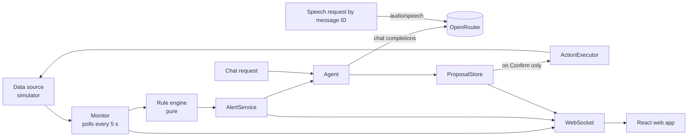

# 👻 Haunted Homelab

An AI sysadmin ghost that watches your homelab. It raises spooky alerts when something breaks, answers questions about your containers in a ghostly voice, and proposes fixes that run only after you click **Confirm**.

All AI traffic goes through [OpenRouter](https://openrouter.ai) with a single API key: one model writes the replies and another speaks them.


> **Status:** simulator MVP. The app runs against a built-in simulated homelab. A real Docker data source is designed but not built yet (see [Project status](#project-status)).

## Features

- **Live status panel.** Host CPU, memory, and disk usage per mount, plus every container's state, CPU, and memory. Values update over a WebSocket every poll (5 s by default).
- **Haunting alerts.** Rules for sustained high CPU, memory, disk, exited containers, restart loops, unknown high-CPU containers, and an unreachable data source. Each alert appears as a popup and is spoken aloud. A recovery popup appears when the problem clears.
- **Chat with the ghost.** Ask "Is plex okay?" or "Summarize the pihole logs". Answers use a fresh snapshot and the container's recent logs. Log summaries list each error and warning with its timestamp.
- **Numbers you can trust.** A fact guard checks every percentage and byte value in an LLM reply against the real data. If a number is invented, the ghost retries once, then falls back to a template built from the facts.
- **Human-in-the-loop actions.** The ghost can propose `restart` or `stop` on a real container, from chat or from an alert. Nothing runs until you click **Confirm**. Proposals expire after 5 minutes, and each one runs at most once.
- **Voice.** Replies and alerts are spoken through OpenRouter text-to-speech, one clip at a time. Voice is on by default and can be switched off.
- **Incident simulator.** Stage a CPU spike, memory leak, full disk, container crash, or restart loop from the UI and watch the ghost react.

## Quick start

Requirements:

- Node.js 22.22.2+, 24.15+, or 26+
- An [OpenRouter API key](https://openrouter.ai/keys)

```bash
npm install

# macOS / Linux
export HAUNTED_OPENROUTER_API_KEY=sk-or-v1-...
# Windows PowerShell
$env:HAUNTED_OPENROUTER_API_KEY = "sk-or-v1-..."

npm run dev
```

Open <http://localhost:5173>. `npm run dev` starts the backend on port 3000 and the Vite dev server, which proxies `/api` and `/ws` to it.

For a production build:

```bash
npm run build
npm start        # serves the built UI and API on http://127.0.0.1:3000
```

## Demo walkthrough

1. Click **Wake the ghost** once. Browsers block audio until you interact with the page.
2. In **Summon an incident**, choose **Container crash**, pick `plex`, and click **Stage**.
3. Within one poll a critical popup appears and the ghost announces the crash. The popup includes a proposal to restart `plex`.
4. Ask the ghost "Is plex okay?" or "Summarize the plex logs".
5. Click **Confirm** on the proposal. The ghost reports the result, `plex` returns to `running`, and a recovery popup appears.
6. Click **Clear all** to reset the simulator.

Other incidents to try:

| Incident | Effect |
|---|---|
| CPU spike | Host CPU at 96–99 % and a new `unknown-process-x13` container. The new container alerts at once; the host CPU alert waits for 30 s of sustained load. |
| Memory leak | The chosen container's memory grows on every poll until host memory reaches 95 %, then holds. |
| Disk full | `/` jumps to 97 %. |
| Container crash | The container exits and writes three error lines to its log. |
| Container restart loop | The container stays in `restarting` and logs a startup failure every tick. |

## Configuration

Settings come from environment variables, then an optional JSON config file, then defaults. To use a file, copy [`haunted.config.example.json`](haunted.config.example.json) to `haunted.config.json` (git-ignored) and set `HAUNTED_CONFIG=haunted.config.json`. Invalid settings stop the server at startup with a message naming each problem.

| Environment variable | Config file key | Default |
|---|---|---|
| `HAUNTED_OPENROUTER_API_KEY` | `openrouter.apiKey` | **required** |
| `HAUNTED_OPENROUTER_BASE_URL` | `openrouter.baseUrl` | `https://openrouter.ai/api/v1` |
| `HAUNTED_LLM_MODEL` | `llm.model` | `openai/gpt-4o-mini` |
| `HAUNTED_TTS_MODEL` | `tts.model` | `openai/gpt-4o-mini-tts-2025-12-15` |
| `HAUNTED_TTS_VOICE` | `tts.voice` | `onyx` |
| `HAUNTED_TTS_INSTRUCTIONS` | `tts.instructions` | A slow, eerie whisper. An empty value sends no instructions. |
| `HAUNTED_DATA_SOURCE` | `dataSource` | `simulator` (`docker` is not built yet) |
| `HAUNTED_DOCKER_ENDPOINT` | `docker.endpoint` | `unix:///var/run/docker.sock`, or `npipe:////./pipe/docker_engine` on Windows |
| `HAUNTED_POLL_INTERVAL_MS` | `monitor.pollIntervalMs` | `5000` (minimum 1000) |
| `HAUNTED_CPU_THRESHOLD` | `thresholds.cpuPercent` | `90` |
| `HAUNTED_CPU_DURATION_S` | `thresholds.cpuDurationSeconds` | `30` |
| `HAUNTED_MEMORY_THRESHOLD` | `thresholds.memoryPercent` | `90` |
| `HAUNTED_DISK_THRESHOLD` | `thresholds.diskPercent` | `90` |
| `HAUNTED_HOST` | `server.host` | `127.0.0.1` |
| `HAUNTED_PORT` | `server.port` | `3000` |
| `HAUNTED_SIM_SEED` | `simulator.seed` | `1337` |

Any OpenRouter model slug works for `HAUNTED_LLM_MODEL`. Voice names differ between TTS models, so changing `HAUNTED_TTS_MODEL` may also require a different `HAUNTED_TTS_VOICE`.

## How it works



- **Backend:** Node.js, TypeScript, Fastify, zod, and pino. The monitor reads a snapshot on a fixed schedule. A pure rule engine turns snapshots into raised and resolved alerts without duplicates.
- **Agent:** builds a fact sheet from the current snapshot, adds the relevant container logs, and asks the LLM for a JSON reply. Replies are capped at 120 words and alert messages at 40. Every number in a reply is checked against the facts.
- **Actions:** the `ActionExecutor` is reachable only from `ProposalStore.confirm`. No route or LLM output can restart or stop a container directly.
- **Speech:** the browser requests audio by message ID. The server only speaks text it produced itself, and caches each clip.
- **Frontend:** React 18, zustand, and Vite. Chat history is kept in `sessionStorage` for the browser session.

The full requirements, design, and task plan are in [`.kiro/specs/haunted-homelab`](.kiro/specs/haunted-homelab).

## Security and privacy

- **Localhost by default.** The server binds to `127.0.0.1` and has **no authentication**. Do not expose it to a network you don't trust.
- **Origin check.** POST and DELETE requests and WebSocket upgrades are rejected with 403 unless they come from the server's own loopback origin or the Vite dev origin (`http://localhost:5173`). Requests without an `Origin` header, such as curl, are allowed.
- **Secrets stay on the server.** The API key is never sent to the browser and is scrubbed from every log line.
- **What leaves your machine.** Host metrics, container names, log excerpts, and your questions go to OpenRouter and the provider of the configured LLM model. Only server-written reply and alert text goes to the TTS model. The page footer states this and names both models.

## Project status

| Area | Status |
|---|---|
| Simulator data source, alerts, chat, voice, proposals, web UI | Done |
| Docker data source (`HAUNTED_DATA_SOURCE=docker`) | Designed, not built. Selecting it stops the server with a clear message. |
| Public hosting | Not supported yet. The origin check only allows loopback origins, so a hosted URL gets 403 on chat, actions, and live updates. A setting for allowed public origins is needed first. |
| Optional property and integration tests in the spec | Not written |

## Development

| Script | What it does |
|---|---|
| `npm run dev` | Backend with reload (`tsx watch`) plus the Vite dev server |
| `npm run build` | Compiles the server to `dist/server` and the web app to `dist/web` |
| `npm start` | Runs the production build |
| `npm test` | Runs every test once with Vitest |
| `npm run lint` | ESLint, including a rule that allows `dockerode` and `systeminformation` only under `src/server/datasource/` |

Tests use Vitest, fast-check, and Testing Library, with mock LLM and TTS providers. They make no network calls.

```text
src/
  shared/        types and formatters used by both sides
  server/
    config/      settings, validation, browser-safe projection
    datasource/  DataSource interface and the simulator
    monitor/     rule engine and polling scheduler
    alerts/      AlertService, message templates, proposal policy
    agent/       Agent, prompts, fact guard, log events
    actions/     ProposalStore and ActionExecutor
    llm/ tts/    OpenRouter clients
    http/        routes, WebSocket hub, origin guard
    app.ts       wires the backend together (mock providers in tests)
    main.ts      entry point
  web/           React app: components, store, REST and socket clients, audio queue
test/            mirrors src/
```
