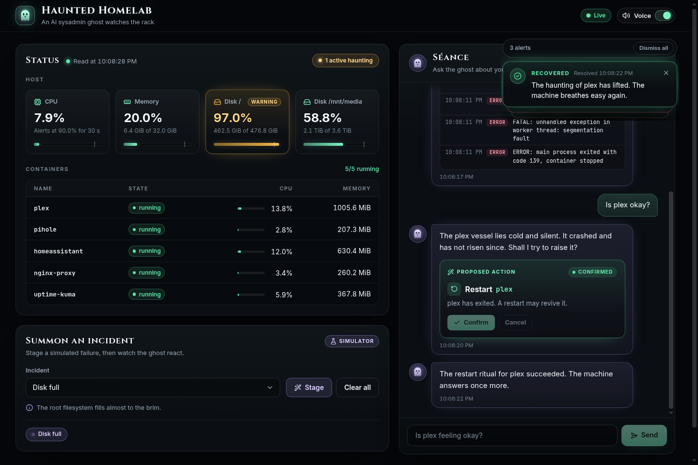
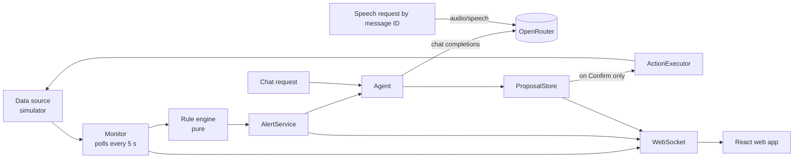

# 👻 Haunted Homelab

An AI sysadmin ghost that watches your homelab. It raises spooky alerts when something breaks, answers questions about your containers in a ghostly voice, and proposes fixes that run only after you click **Confirm**.

All AI traffic goes through [OpenRouter](https://openrouter.ai) with a single API key: one model writes the replies and another speaks them.

**Live demo:** <https://haunted-homelab.onrender.com>. The free server sleeps when idle, so the first visit can take about a minute. Then follow the [demo walkthrough](#demo-walkthrough).



> **Status:** the live demo runs against a built-in simulated homelab, so anyone can crash containers safely. The AI, voice, alerts, and actions are real. A real Docker data source is designed but not built yet (see [Project status](#project-status)).

Built for **Kiroween 2026** with [Kiro](https://kiro.dev). See [Built with Kiro](#built-with-kiro).

## Features

- **Live status panel.** Host CPU, memory, and disk usage per mount, plus every container's state, CPU, and memory. Values update over a WebSocket every poll (5 s by default).
- **Haunting alerts.** Rules for sustained high CPU, memory, disk, exited containers, restart loops, unknown high-CPU containers, and an unreachable data source. Each alert appears as a popup and is spoken aloud. A recovery popup appears when the problem clears.
- **Chat with the ghost.** Ask "Is plex okay?" or "Summarize the pihole logs". Answers use a fresh snapshot and the container's recent logs. Log summaries list each error and warning with its timestamp.
- **Numbers you can trust.** A fact guard checks every percentage and byte value in an LLM reply against the real data. If a number is invented, the ghost retries once, then falls back to a template built from the facts.
- **Human-in-the-loop actions.** The ghost can propose `restart` or `stop` on a real container, from chat or from an alert. Nothing runs until you click **Confirm**. Proposals expire after 5 minutes, and each one runs at most once.
- **Voice.** Replies and alerts are spoken through OpenRouter text-to-speech, one clip at a time. Voice is on by default and can be switched off.
- **Incident simulator.** Stage a CPU spike, memory leak, full disk, container crash, or restart loop from the UI and watch the ghost react.

## Quick start

Requirements:

- Node.js 22.22.2+, 24.15+, or 26+
- An [OpenRouter API key](https://openrouter.ai/keys)

```bash
npm install

# macOS / Linux
export HAUNTED_OPENROUTER_API_KEY=sk-or-v1-...
# Windows PowerShell
$env:HAUNTED_OPENROUTER_API_KEY = "sk-or-v1-..."

npm run dev
```

Open <http://localhost:5173>. `npm run dev` starts the backend on port 3000 and the Vite dev server, which proxies `/api` and `/ws` to it.

For a production build:

```bash
npm run build
npm start        # serves the built UI and API on http://127.0.0.1:3000
```

## Demo walkthrough

1. Click **Wake the ghost** once. Browsers block audio until you interact with the page.
2. In **Summon an incident**, choose **Container crash**, pick `plex`, and click **Stage**.
3. Within one poll a critical popup appears and the ghost announces the crash. The popup includes a proposal to restart `plex`.
4. Ask the ghost "Is plex okay?" or "Summarize the plex logs".
5. Click **Confirm** on the proposal. The ghost reports the result, `plex` returns to `running`, and a recovery popup appears.
6. Click **Clear all** to reset the simulator.

Other incidents to try:

| Incident | Effect |
|---|---|
| CPU spike | Host CPU at 96–99 % and a new `unknown-process-x13` container. The new container alerts at once; the host CPU alert waits for 30 s of sustained load. |
| Memory leak | The chosen container's memory grows on every poll until host memory reaches 95 %, then holds. |
| Disk full | `/` jumps to 97 %. |
| Container crash | The container exits and writes three error lines to its log. |
| Container restart loop | The container stays in `restarting` and logs a startup failure every tick. |

## Configuration

Settings come from environment variables, then an optional JSON config file, then defaults. To use a file, copy [`haunted.config.example.json`](haunted.config.example.json) to `haunted.config.json` (git-ignored) and set `HAUNTED_CONFIG=haunted.config.json`. Invalid settings stop the server at startup with a message naming each problem.

| Environment variable | Config file key | Default |
|---|---|---|
| `HAUNTED_OPENROUTER_API_KEY` | `openrouter.apiKey` | **required** |
| `HAUNTED_OPENROUTER_BASE_URL` | `openrouter.baseUrl` | `https://openrouter.ai/api/v1` |
| `HAUNTED_LLM_MODEL` | `llm.model` | `openai/gpt-4o-mini` |
| `HAUNTED_TTS_MODEL` | `tts.model` | `openai/gpt-4o-mini-tts-2025-12-15` |
| `HAUNTED_TTS_VOICE` | `tts.voice` | `onyx` |
| `HAUNTED_TTS_INSTRUCTIONS` | `tts.instructions` | A slow, eerie whisper. An empty value sends no instructions. |
| `HAUNTED_DATA_SOURCE` | `dataSource` | `simulator` (`docker` is not built yet) |
| `HAUNTED_DOCKER_ENDPOINT` | `docker.endpoint` | `unix:///var/run/docker.sock`, or `npipe:////./pipe/docker_engine` on Windows |
| `HAUNTED_POLL_INTERVAL_MS` | `monitor.pollIntervalMs` | `5000` (minimum 1000) |
| `HAUNTED_CPU_THRESHOLD` | `thresholds.cpuPercent` | `90` |
| `HAUNTED_CPU_DURATION_S` | `thresholds.cpuDurationSeconds` | `30` |
| `HAUNTED_MEMORY_THRESHOLD` | `thresholds.memoryPercent` | `90` |
| `HAUNTED_DISK_THRESHOLD` | `thresholds.diskPercent` | `90` |
| `HAUNTED_HOST` | `server.host` | `127.0.0.1`, or `0.0.0.0` on Render (detected through `RENDER=true`). Use `0.0.0.0` on other hosting platforms. |
| `HAUNTED_PORT` | `server.port` | The platform's `PORT` if set, otherwise `3000` |
| `HAUNTED_ALLOWED_ORIGINS` | `server.allowedOrigins` | Render's `RENDER_EXTERNAL_URL` if set, otherwise none. Comma-separated, e.g. `https://ghost.example.com`. |
| `HAUNTED_SIM_SEED` | `simulator.seed` | `1337` |
| `HAUNTED_DAILY_LLM_CALLS` | `limits.dailyLlmCalls` | `600` LLM calls per day (chat and alert messages) |
| `HAUNTED_DAILY_SPEECH_CLIPS` | `limits.dailySpeechClips` | `300` new speech clips per day |

Any OpenRouter model slug works for `HAUNTED_LLM_MODEL`. Voice names differ between TTS models, so changing `HAUNTED_TTS_MODEL` may also require a different `HAUNTED_TTS_VOICE`.

## How it works



- **Backend:** Node.js, TypeScript, Fastify, zod, and pino. The monitor reads a snapshot on a fixed schedule. A pure rule engine turns snapshots into raised and resolved alerts without duplicates.
- **Agent:** builds a fact sheet from the current snapshot, adds the relevant container logs, and asks the LLM for a JSON reply. Replies are capped at 120 words and alert messages at 40. Every number in a reply is checked against the facts.
- **Actions:** the `ActionExecutor` is reachable only from `ProposalStore.confirm`. No route or LLM output can restart or stop a container directly.
- **Speech:** the browser requests audio by message ID. The server only speaks text it produced itself, and caches each clip.
- **Frontend:** React 18, zustand, and Vite. Chat history is kept in `sessionStorage` for the browser session.

The full requirements, design, and task plan are in [`.kiro/specs/haunted-homelab`](.kiro/specs/haunted-homelab).

## Deploy on Render (free)

Render's free web service runs the whole app, WebSocket included.

1. Create a **Web Service** from this repository and pick the **Free** instance type.
2. Set **Build Command** to `npm ci && npm run build` and **Start Command** to `npm start`.
3. Add one environment variable: `HAUNTED_OPENROUTER_API_KEY` with your OpenRouter key.

That's all. On Render the server listens on `0.0.0.0` at Render's `PORT` and accepts browser requests from the service's own `https://….onrender.com` URL, using the `RENDER`, `PORT`, and `RENDER_EXTERNAL_URL` variables Render sets for every service. If you add a custom domain, set `HAUNTED_ALLOWED_ORIGINS` to every origin you use, including the `onrender.com` one.

Free services sleep after 15 minutes without traffic and take about a minute to wake, so open the page shortly before a demo. Alerts, chat, and staged incidents are kept in memory and reset when the service sleeps or redeploys.

**Before sharing the URL:** there is no login, so anyone with the link can chat and trigger speech on your OpenRouter credits. Built-in [usage limits](#security-and-privacy) cap the damage, but also set a [credit limit on the key](https://openrouter.ai/keys). Actions only affect simulated containers.

To keep the demo awake for visitors, point a free uptime monitor (for example UptimeRobot) at `https://<your-service>.onrender.com/api/config` every 5 minutes. Render's 750 free hours a month cover one service running all month.

## Security and privacy

- **Localhost by default.** The server binds to `127.0.0.1` and has **no authentication**. Only expose it, for example on Render, if you accept that anyone with the URL can use it.
- **Origin check.** POST and DELETE requests and WebSocket upgrades are rejected with 403 unless they come from the server's own loopback origin, the Vite dev origin (`http://localhost:5173`), or an origin listed in `HAUNTED_ALLOWED_ORIGINS`. Requests without an `Origin` header, such as curl, are allowed. Rejected origins are logged.
- **Usage limits.** Each visitor can ask 15 questions and fetch 40 new speech clips per 10 minutes. Above that, the server answers 429 with a persona message and `Retry-After`. Daily caps (`HAUNTED_DAILY_LLM_CALLS`, `HAUNTED_DAILY_SPEECH_CLIPS`) bound total AI spend. When the LLM cap is reached, chat is refused and alert messages use their templates. Replaying a cached clip is free.
- **Secrets stay on the server.** The API key is never sent to the browser and is scrubbed from every log line.
- **What leaves your machine.** Host metrics, container names, log excerpts, and your questions go to OpenRouter and the provider of the configured LLM model. Only server-written reply and alert text goes to the TTS model. The page footer states this and names both models.

## Built with Kiro

The whole project was built in Kiro, spec first. Everything Kiro used is in [`.kiro/`](.kiro).

### Spec-driven development

[`.kiro/specs/haunted-homelab`](.kiro/specs/haunted-homelab) holds the three spec documents:

- **[`requirements.md`](.kiro/specs/haunted-homelab/requirements.md):** 13 requirements with 80 acceptance criteria written as EARS statements ("WHEN the user clicks the Confirm control… THE Action_Executor SHALL…"). A glossary fixes the terms used everywhere else (Data_Source, Haunting_Alert, Action_Proposal).
- **[`design.md`](.kiro/specs/haunted-homelab/design.md):** architecture, interfaces, and data models. It also lists numbered correctness properties tied to requirements, for example "a proposal's action runs at most once", "alert and recovery messages carry the measured value verbatim", and "secrets never leave the backend". Design decisions that protect users became hard rules there:
  - the action executor is reachable only from a confirmed proposal;
  - speech is requested by message ID, so the server never speaks arbitrary text;
  - the rule engine is a pure function.
- **[`tasks.md`](.kiro/specs/haunted-homelab/tasks.md):** 100 tasks, each tied to requirement IDs, with a dependency graph in waves and three test checkpoints. Optional tasks (property tests, the Docker source) are marked `*`, which made the MVP scope explicit and traceable instead of silently cut.

Kiro then ran the plan with **Run all tasks**. Independent tasks in the same wave went to parallel sub-agents: config, logging, and data-source types were built at the same time, then the simulator, rule engine, proposals, and LLM/TTS clients. At each checkpoint Kiro ran the full suite. Kiro also reported what the design left open, for example that Render needs `0.0.0.0` and that the origin guard needed public origins, and fixed it.

Compared with vibe coding, the spec made the safety properties testable before any code existed. The tests check exactly what the design promised: proposals expire at 5 minutes inclusive, a second confirm is rejected while the first is running, and invented numbers trigger a retry and then a template.

### Vibe coding

After the spec was implemented, conversational sessions handled the parts a spec doesn't cover well:

- **UI polish.** Kiro wrote a throwaway preview server with mock AI providers and drove headless Chrome to screenshot the app at desktop and phone widths. It then fixed what the screenshots showed: popups covering controls, a table overflowing on mobile, and alert proposals that were never rendered.
- **Deployment.** Kiro read the Render logs and moved the server to Render's `PORT` and `0.0.0.0`. It then added allowed origins and per-visitor and daily usage limits for a public demo.

### Steering

- [`project.md`](.kiro/steering/project.md) is always included. It covers the import style, the architecture rules that must never break (only a confirmed proposal can act, speech by message ID only), secret handling, and the commands Kiro may run (tests once, never in watch mode).
- [`web-ui.md`](.kiro/steering/web-ui.md) is included only for files under `src/web/`. It covers the design tokens, shared primitives, overflow rules, and the accessibility roles that the tests rely on.

### Hooks

- [`check-after-task`](.kiro/hooks/check-after-task.json) runs `npm run check` (type-check, lint, and every test) whenever a spec task is marked complete, so no task is left done with broken code.

## Project status

| Area | Status |
|---|---|
| Simulator data source, alerts, chat, voice, proposals, web UI | Done |
| Docker data source (`HAUNTED_DATA_SOURCE=docker`) | Designed, not built. Selecting it stops the server with a clear message. |
| Public hosting | Works on Render (see [Deploy on Render](#deploy-on-render-free)). There is no authentication. |
| Optional property and integration tests in the spec | Not written |

## Development

| Script | What it does |
|---|---|
| `npm run dev` | Backend with reload (`tsx watch`) plus the Vite dev server |
| `npm run build` | Compiles the server to `dist/server` and the web app to `dist/web` |
| `npm start` | Runs the production build |
| `npm test` | Runs every test once with Vitest |
| `npm run check` | Type-check, lint, and every test |
| `npm run lint` | ESLint, including a rule that allows `dockerode` and `systeminformation` only under `src/server/datasource/` |

Tests use Vitest, fast-check, and Testing Library, with mock LLM and TTS providers. They make no network calls.

```text
src/
  shared/        types and formatters used by both sides
  server/
    config/      settings, validation, browser-safe projection
    datasource/  DataSource interface and the simulator
    monitor/     rule engine and polling scheduler
    alerts/      AlertService, message templates, proposal policy
    agent/       Agent, prompts, fact guard, log events
    actions/     ProposalStore and ActionExecutor
    llm/ tts/    OpenRouter clients
    http/        routes, WebSocket hub, origin guard
    app.ts       wires the backend together (mock providers in tests)
    main.ts      entry point
  web/           React app: components, store, REST and socket clients, audio queue
test/            mirrors src/
```

## License

[MIT](LICENSE)
